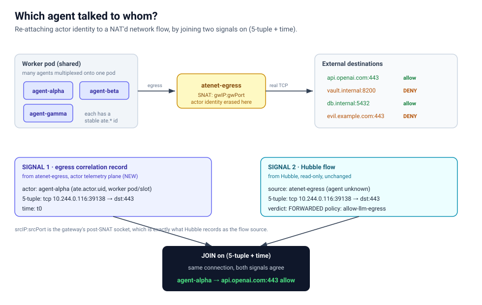

# Agent Identity to Network Correlation (PoC)

Answers **"which agent talked to whom"** in Agent Substrate by correlating actor
identity with Cilium/Hubble network flows, including external destinations reached
through the egress gateway, where NAT otherwise erases the actor.

**Hubble is not modified.** It is consumed read-only. The only new signal is a
per-connection *correlation record* emitted by `atenet-egress` on the actor
telemetry plane.



## Example output

Running `go run .` against the bundled sample feeds produces this. The first block is
the answer; the last block shows what you are left with **without** the correlation,
so the gap is obvious.

```text
WHO TALKS TO WHOM  (actor identity re-attached to NAT'd flows)
================================================================================
AGENT         ATESPACE  DESTINATION            VERDICT  POLICY           WORKER
--------------------------------------------------------------------------------
agent-alpha   demo      api.openai.com:443     allow    allow-llm-egress counter-pool-abc#0
agent-alpha   demo      vault.internal:8200    DENY     default-deny     counter-pool-abc#0
agent-beta    demo      db.internal:5432       allow    allow-db         counter-pool-abc#1
agent-gamma   demo      api.openai.com:443     allow    allow-llm-egress counter-pool-xyz#0
agent-gamma   demo      evil.example.com:443   DENY     default-deny     counter-pool-xyz#0

CORRELATION GRAPH
================================================================================
demo/agent-alpha  (pod counter-pool-abc#0)
   ├──► api.openai.com:443       ✓ FORWARDED  policy=allow-llm-egress
   └──► vault.internal:8200      ✗ DROPPED    policy=default-deny

demo/agent-beta  (pod counter-pool-abc#1)
   └──► db.internal:5432         ✓ FORWARDED  policy=allow-db

demo/agent-gamma  (pod counter-pool-xyz#0)
   ├──► api.openai.com:443       ✓ FORWARDED  policy=allow-llm-egress
   └──► evil.example.com:443     ✗ DROPPED    policy=default-deny

WHAT HUBBLE SEES ALONE  (no egress record: actor erased by NAT)
================================================================================
   ate-system/atenet-egress ──► api.openai.com:443   allow      (which agent? unknown, source is the gateway)
   ate-system/atenet-egress ──► vault.internal:8200   DENY       (which agent? unknown, source is the gateway)
   ate-system/atenet-egress ──► db.internal:5432   allow      (which agent? unknown, source is the gateway)
   ate-system/atenet-egress ──► api.openai.com:443   allow      (which agent? unknown, source is the gateway)
   ate-system/atenet-egress ──► evil.example.com:443   DENY       (which agent? unknown, source is the gateway)
```

Read it top to bottom: the correlation names the agent behind every flow and its
Cilium policy verdict; Hubble on its own can only report the gateway as the source.

## Run

```sh
go run .                      # uses ./data
go run . -window=5s           # widen the 5-tuple time-match window
go run . -data=/path/to/dir   # point at other sample feeds
```

Stdlib only, no external dependencies, runs offline.

## The idea

Agents `agent-alpha` and `agent-beta` share a worker pod. When they reach an external
destination, `atenet-egress` SNATs the connection, so Hubble sees the flow coming from
the gateway pod, not from the agent. Hubble alone can report `atenet-egress ──► dst`
with a policy verdict, but it cannot name the agent.

The fix is a second signal. `atenet-egress` emits a per-connection correlation record on
the actor telemetry plane holding the actor identity, the worker pod/slot, and the
post-SNAT 5-tuple. That record and the Hubble flow describe the **same connection**, so
matching them on `(5-tuple + time)` re-attaches the actor identity Hubble lost. See the
diagram above.

## Mapping to the real signals

The PoC reads two JSON feeds that are shaped exactly like the real sources, so replacing
them with real exports leaves the join logic unchanged.

`data/egress_records.json` stands in for the `atenet-egress` correlation record on the
actor telemetry plane. This is the one piece of new instrumentation to add, and it
depends on #853 landing to provide trusted actor identity.

`data/hubble_flows.json` stands in for the Hubble Relay flow API (or flow logs). This
already exists and is consumed read-only, with Hubble unchanged.

## What this PoC proves and does not prove

It **proves** the correlation algorithm: re-attaching actor identity to a NAT'd network
flow and its Cilium policy verdict, at per-agent granularity, for co-located agents
sharing a pod.

It **does not prove** the live wiring. It uses synthetic feeds shaped like the real ones
because the egress correlation record does not exist yet and #853 (trusted actor identity
on telemetry) is not merged.

## Join keys

**External egress:** `(proto, srcIP, srcPort, dstIP, dstPort)` plus a time window.
`srcIP:srcPort` is the gateway's post-SNAT socket, which is exactly what Hubble observes
as the flow source.

**Intra-cluster (not in this PoC):** `k8s.pod.uid`, the worker pod UID that #853 stamps
on actor telemetry, joined to Hubble's pod identity. This gives pod-level (not per-agent)
correlation, which is the right granularity for control-plane flows.
